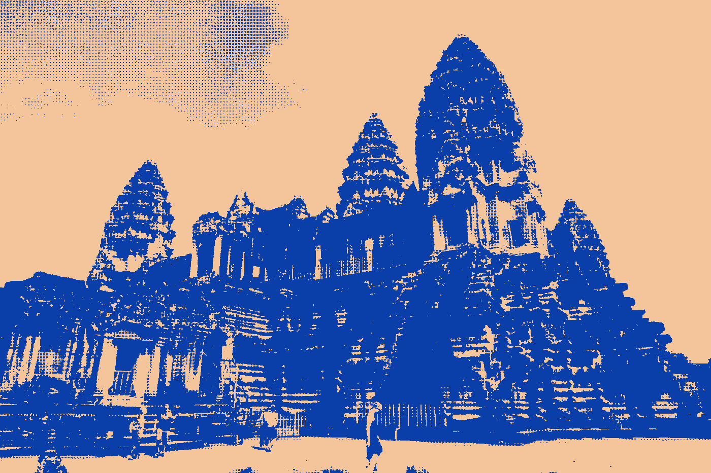

# Vintage Art Engine

Convert photographs into bold, two-tone vintage-style artwork using a square mesh halftone, circular dots, or blocky dithering.



## Features

- Converts common image formats supported by Pillow into RGB PNG artwork.
- Three rendering styles: `mesh`, `dots`, and `dither`.
- Adjustable contrast, gamma, blur, local contrast, grain, tone range, and output scale.
- Custom background and foreground colors using hexadecimal values.
- Reproducible results through a configurable random seed.

## Requirements

- Python 3.9+
- Pillow
- NumPy

Install the dependencies with:

```bash
python -m pip install pillow numpy
```

## Usage

Run the engine from this directory:

```bash
python py-engine.py input.png output.png
```

The default renderer uses the mesh style with a cobalt-blue background and peach foreground. Select another style or customize the palette with options:

```bash
python py-engine.py input.jpg poster.png \
  --mode dots \
  --bg "#101820" \
  --fg "#F2AA4C" \
  --cell 8 \
  --contrast 1.7
```

### Rendering modes

| Mode | Description |
| --- | --- |
| `mesh` | Square screen pattern with holes that shrink as tones become brighter. |
| `dots` | Circular halftone dots whose size follows the source image tones. |
| `dither` | Blocky ordered dithering for a pixel-art appearance. |

## Options

| Option | Default | Purpose |
| --- | ---: | --- |
| `--mode` | `mesh` | Rendering mode: `mesh`, `dots`, or `dither`. |
| `--width` | `1400` | Working width in pixels before rendering. |
| `--cell` | `6` | Mesh/dot cell size, or dither block size. |
| `--contrast` | `1.5` | Global contrast multiplier. |
| `--gamma` | `1.0` | Tone curve; values below 1 brighten and values above 1 darken. |
| `--blur` | `0.8` | Gaussian blur applied before tone mapping. |
| `--local` | `0.8` | Local contrast enhancement. |
| `--grain` | `0.07` | Random variation that breaks up edges. |
| `--floor` | `0.25` | Lower tone cutoff. |
| `--ceil` | `0.95` | Upper tone cutoff. |
| `--bg` | `#0A3EA8` | Background color. |
| `--fg` | `#F4C49A` | Foreground color. |
| `--invert` | off | Invert the source tones before rendering. |
| `--scale` | `1` | Nearest-neighbour upscale factor. |
| `--seed` | `7` | Random seed for repeatable grain. |

To see every available argument:

```bash
python py-engine.py --help
```

## How it works

1. The input image is orientation-corrected, converted to grayscale, and resized.
2. Contrast, blur, gamma, and local contrast adjustments create a normalized tone map.
3. The selected renderer converts that tone map into a binary foreground mask.
4. The mask is composited onto the chosen two-color palette and saved to the output path.

## License

No license is currently specified. The current project developed to convert any image, especially tourism photograph, to turn it into vintage unforgetable memories.
